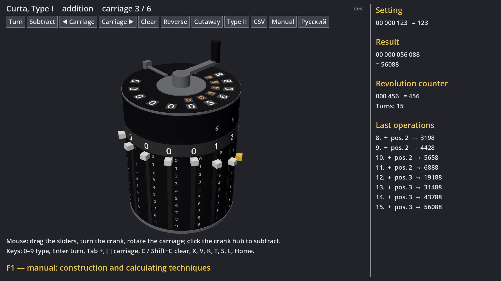
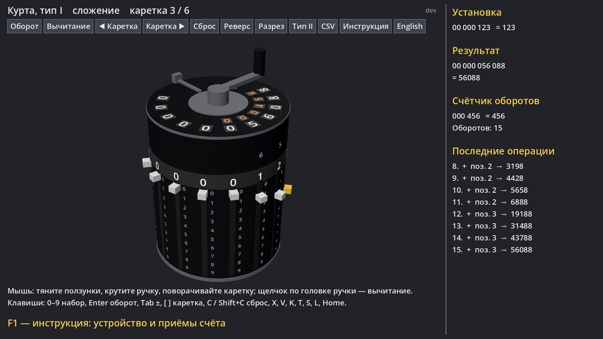

# Curta Calculator

[English](#english) · [Русский](#русский)

## English

An interactive 3D model of the **Curta** — the pocket mechanical calculator invented by Curt Herzstark and
made in Liechtenstein from 1948 to the early 1970s. Set numbers on the sliders, turn the crank, shift the
carriage, pull the crank up to subtract, and look inside: the cutaway view shows the stepped drum with its
interleaved addition and complement teeth and the slider pinions turning n/10 of a revolution per crank turn.
Both Type I (8 / 6 / 11 digits) and Type II (11 / 8 / 15) are modelled.



**Download (Windows):** the latest build is on the [Releases](https://github.com/avv123avv/curt_calculator/releases/latest)
page — unpack the zip and run `CurtaCalculator.exe`. Every merge into `main` publishes a new version automatically.

**Run from source:** Godot 4.7 → Import → select `project.godot` → F5. The screen is 1920×1080 and scales down
to smaller displays (e.g. Steam Deck; touch works as a mouse). The UI language follows the system on first launch;
switch with the **English / Русский** button or the **L** key.

### Controls

| Keys | Mouse | Action |
|---|---|---|
| 0–9, Backspace | drag a slider knob, wheel over it | set the number (digits shift in from the right) |
| ← / →, ↑ / ↓ | — | select a slider, move it up / down |
| Enter, Space | turn the crank clockwise | one turn = add (or subtract) the setting |
| Tab | click the crank hub | crank up (subtract, red ring) / down (add) |
| [ / ] | rotate the carriage | shift by one digit |
| C | sweep the clearing lever a full circle | clear result and counter |
| Shift+C | — | clear the counter only |
| V | click the switch on the carriage | counter reverse (for division and square root) |
| X | — | sliders to 0 |
| K | “Cutaway” | transparent body, stepped drum and pinions |
| T | “Type II” / “Type I” | switch the model |
| S | “CSV” | log to `user://curta_log.csv` (`n,op,carriage,setting,result,counter`) |
| Home | drag empty space / right drag, wheel | reset / orbit / zoom the view |
| F1 | “Manual” | in-game manual (←/→ pages, O opens the PDF) |

The button row at the top (as in lukyanov_integrator) repeats the main actions: Turn, Subtract / Add, ◀ Carriage ▶, Clear,
Reverse, Cutaway, Type, CSV, Manual and the language; the active mode is outlined in yellow.
While the crank is away from home the carriage, crank mode and clearing lever are locked, as on the real machine.

### Manual

[`docs/instruction_en.pdf`](docs/instruction_en.pdf) — history, parts, how the stepped drum and complement
subtraction work, controls, and worked examples: addition and subtraction, multiplication by shifts (including
short-cut 123 × 99), division by repeated subtraction, and square root by odd numbers (Toepler’s method).
All example tables are computed by a Python mirror of the model.

Both PDFs and the F1 pages (`docs/pages/<lang>/`) are generated by:

```
pip install reportlab pypdfium2
python docs/build_instruction.py
```

The screenshots in the manual and this README come from `godot --path . -s docs/screenshot.gd -- --lang=en`.

### Development

- `curta_model.gd` — the mechanism without rendering (registers, stepped drum, carries, counter, CSV log).
- `curta_3d.gd` / `curta_3d.tscn` — the 3D model and UI (main scene); `curta_calculator.gd` / `main.tscn` — the
  original abstract 2D scheme.
- Tests: `godot --headless --path . --import`, then `godot --headless --path . -s tests/run_tests.gd`
  (arithmetic, mouse drags in 3D, manual pages, translations, CSV).

## Русский

Интерактивная 3D-модель **«Курты»** — карманного механического калькулятора Курта Херцштарка, который
выпускали в Лихтенштейне с 1948 года до начала 1970-х. Набирайте числа ползунками, крутите ручку, сдвигайте
каретку, вытягивайте ручку для вычитания — и загляните внутрь: в разрезе виден ступенчатый вал с чередующимися
зубьями сложения и дополнения и шестерни ползунков, которые за оборот ручки поворачиваются на n/10.
Есть оба типа: I (8 / 6 / 11 разрядов) и II (11 / 8 / 15).



**Скачать (Windows):** последняя сборка — на странице [Releases](https://github.com/avv123avv/curt_calculator/releases/latest):
распакуйте zip и запустите `CurtaCalculator.exe`. Каждое слияние в `main` автоматически выпускает новую версию.

**Запуск из исходников:** Godot 4.7 → Import → выбрать `project.godot` → F5. Экран 1920×1080, масштабируется под
меньшие (например, Steam Deck; касания работают как мышь). Язык при первом запуске — как в системе; переключение —
кнопкой **English / Русский** или клавишей **L**.

### Управление

| Клавиши | Мышь | Действие |
|---|---|---|
| 0–9, Backspace | тянуть ручку ползунка, колесо над ним | набрать число (цифры вдвигаются справа) |
| ← / →, ↑ / ↓ | — | выбрать ползунок, сдвинуть его вверх / вниз |
| Enter, Пробел | крутить ручку по часовой стрелке | один оборот — прибавить (или вычесть) установку |
| Tab | щелчок по головке ручки | ручка вверх (вычитание, красное кольцо) / вниз (сложение) |
| [ / ] | повернуть каретку | сдвиг на разряд |
| C | провести рычаг сброса полный круг | сбросить результат и счётчик |
| Shift+C | — | сбросить только счётчик |
| V | щелчок по переключателю на каретке | реверс счётчика (для деления и корня) |
| X | — | ползунки в 0 |
| K | «Разрез» | прозрачный корпус, ступенчатый вал и шестерни |
| T | «Тип II» / «Тип I» | сменить модель |
| S | «CSV» | журнал в `user://curta_log.csv` (`n,op,carriage,setting,result,counter`) |
| Home | тянуть по пустому месту / правой кнопкой, колесо | исходный вид / вращение / масштаб |
| F1 | «Инструкция» | инструкция внутри игры (←/→ — страницы, O — открыть PDF) |

Ряд кнопок сверху (как в lukyanov_integrator) повторяет основные действия: Оборот, Вычитание / Сложение, ◀ Каретка ▶,
Сброс, Реверс, Разрез, Тип, CSV, Инструкция и язык; включённый режим обведён жёлтой рамкой.
Пока ручка не вернулась «домой», каретка, режим ручки и рычаг сброса заблокированы — как на настоящей машине.

### Инструкция

[`docs/instruction_ru.pdf`](docs/instruction_ru.pdf) — история, устройство, как работают ступенчатый вал и
вычитание дополнением, управление и разобранные примеры: сложение и вычитание, умножение сдвигами (включая
сокращённое 123 × 99), деление повторным вычитанием, квадратный корень нечётными числами (метод Тёплера).
Все таблицы примеров считает копия модели на Python.

PDF на обоих языках и страницы для F1 (`docs/pages/<lang>/`) собираются скриптом:

```
pip install reportlab pypdfium2
python docs/build_instruction.py
```

Скриншоты для инструкции и README: `godot --path . -s docs/screenshot.gd -- --lang=ru`.

### Разработка

- `curta_model.gd` — механика без отрисовки (регистры, ступенчатый вал, переносы, счётчик, журнал CSV).
- `curta_3d.gd` / `curta_3d.tscn` — 3D-модель и интерфейс (главная сцена); `curta_calculator.gd` / `main.tscn` —
  исходная абстрактная 2D-схема.
- Тесты: `godot --headless --path . --import`, затем `godot --headless --path . -s tests/run_tests.gd`
  (арифметика, перетаскивания мышью в 3D, страницы инструкции, переводы, CSV).
